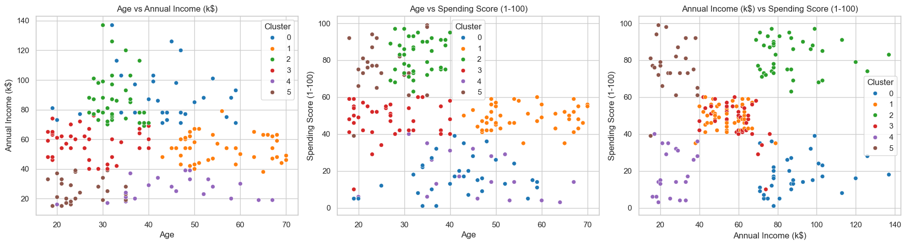
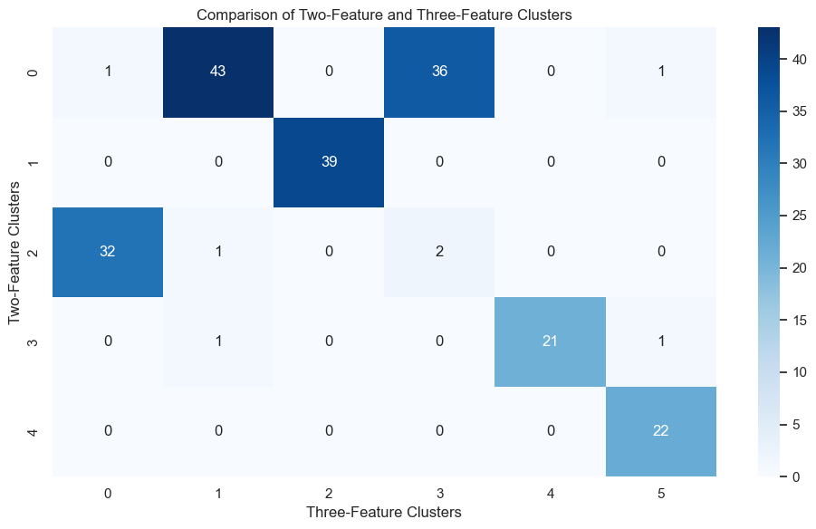

# Customer-Segmentation-with-K-Means
Customer segmentation using Python and K-Means clustering, comparing two-feature and three-feature models to identify customer patterns.

## Project Overview 
How does adding customer age change the segments identified from income and spending behaviour?

This exploratory Python project applies K-Means clustering to a hypothetical mall customer dataset of 200 customers. I first segmented customers using annual income and spending score, then added age as a third feature to investigate whether it revealed additional customer information. I evaluated both models using the elbow method and silhouette scores, described the resulting groups, and compared assigned customer clusters using a cross-tabulation. 

## Dataset
The mall customer dataset is a small, hypothetical dataset with 200 customer records. Its original variables are:

| Variable | Description |
| --- | --- |
| CustomerID | Unique customer identifier | 
| Genre/Gender | Customer gender (renamed to gender in the jupyter notebook) | 
| Age | Age in years |
| Annual Income (k$) | Annual income in thousands of US dollars | 
| Spending Score (1-100) | Customer spending behaviour score, not actual dollars spent |

[Data CSV here](Mall_Customers.csv)

## Key Findings
- **Two-feature baseline:** Five clusters achieved a silhouette score of 0.554.
- **Three-feature experiment:** Six clusters achieved a silhouette score of 0.427, using a standardised scale of age, annual income and spending score.
- **Major Findings:** The original two-feature Cluster 0 contained 81 customers. In the three-feature model, 43 of those customers were assigned to Cluster 1 and 36 to Cluster 3 (other two ended up in Cluster 0 and Cluster 5).
- **Why this matters?** Those two three-feature clusters have similar average incomes ($54.27K and $57.58K) and spending scores (49.07 and 47.79), but very different average age (56.33 and 26.68 years).
- **Interpretation:** Adding Age produced more detailed demographic segments, although three-feature model had a lower silhouette score. Neither model is automatically superior: the appropriate choice depends on the business question and further validation.

## Three-Feature Customer Profiles 

| Clusters | Descriptive Cluster Label  | Avg. Age | Avg. Income | Avg. Spending Score |
| --- | --- | --- | --- | --- | 
| 0 | High-income, Low-spending | 41.94 | $88.94k | 16.97 |
| 1 | Older, Moderate-spending | 56.33 | $54.27k | 49.07 |
| 2 | High-income, High-spending | 32.69 | $86.54k | 82.13 |
| 3 | Younger, Moderate-spending | 26.68 | $57.58k | 47.79 |
| 4 | Low-income, Low-spending | 45.52 | $26.29k | 19.38 |
| 5 | Younger, Low-income, High-spending | 24 | 25.25 | $25.83k | 76.92 |

Cluster labels are arbitrary identifiers, and the descriptive names summarise group averages rather than every customer in each group. 

## Visualisations

### Three-feature cluster projections

These plots show two-dimensional views of clsuters fitted in a three-dimensional feature space. Apparent overlap in one plot does not necessarily mean the customers are close across all three features.

### Cross-tabulation heatmap

The heatmap shows how the original five clsuters map to the six clusters obtained after adding age. The original moderate-income/moderate-spending group is primarily divided between two age-distinct groups; most other groups remian largely together, although thier numerical cluster labels differ. 

## Potential Business Applications
The segments suggests hypotheses a retailer could investigate:
- **High-income, low-spending customers:** Explore product relevance and reasons for low spending scores.
- **High-income, high-spending customers:** Test whether loyalty or premium-product offers are relevant.
- **Older vs younger moderate-spending customers:** Research whether product preferences and preferred communication channels differ; whether it is sending magazines or emails.
- **Lower-income groups:** Investigate value preferences without assuming customers' affordability or motivations.

These are proposed tests, not proven interventions or measured revenue opportunities. 

## Limitations and Next Steps
- The dataset is small and hypothetical; findings should not be generalised to real customers without validation.
- Spending score is an index, not a transaction amount, revenue measure or customer lifetime value.
- K-Means groups observations by distance to centroids and may not capture every real-world customer pattern.
- Silhouette scores from different feature spaces are informative but do not commercially useful.
- Future work could use actual transactions, purchase frequency, product categories and campaign responses; assess clsuter stability; and test segment-specific campaigns.

## Conclusion
The five cluster baseline provides a straightforward view of income and spending-score patterns. Adding age produced six segments and revealed a notable division between older and younger customers with otherwise similar average income and spending scores. This illustrates why customer segmentation should be evaluated not only by a clustering metric by also by interpretability, the business objective and the availability of data for validation. 

## Tools and Techniques 
- **Python**: Pands, NumPy, Matplotlib, Seaborn, scikit-learn
- **Data Exploration:** Data quality checks and exploratory visualisations
- **Unsupervised Learning:** K-Means clsutering and K-Means++ initialisation
- **Feature preprocessing:** StandardScaler for the three-feature model
- **Model Evaluation:** Elbow method (inertia) and silhouette scores
- **Model Comparison:** Cluster profiles, cross-tabulation and heatmap

